<!-- Compact illustrated developer profile. SVG assets follow the viewer's GitHub theme. -->

<picture>
  <source media="(prefers-color-scheme: dark)" srcset="assets/header-dark.svg" />
  <source media="(prefers-color-scheme: light)" srcset="assets/header-light.svg" />
  
</picture>

I write backend software and like pulling systems apart to see how they work. Lately: agent tooling, data integrity, network services and things worth self-hosting.

### Selected work

<a href="https://github.com/thecoolerec/codex-agy-worker-skill">
<picture>
  <source media="(prefers-color-scheme: dark)" srcset="assets/project-1-dark.svg" />
  <source media="(prefers-color-scheme: light)" srcset="assets/project-1-light.svg" />
  
</picture>
</a>

<a href="https://github.com/thecoolerec/api-contract-sync">
<picture>
  <source media="(prefers-color-scheme: dark)" srcset="assets/project-2-dark.svg" />
  <source media="(prefers-color-scheme: light)" srcset="assets/project-2-light.svg" />
  
</picture>
</a>

<a href="https://github.com/thecoolerec/luxury-model-cleaning-skill">
<picture>
  <source media="(prefers-color-scheme: dark)" srcset="assets/project-3-dark.svg" />
  <source media="(prefers-color-scheme: light)" srcset="assets/project-3-light.svg" />
  
</picture>
</a>

<a href="https://github.com/thecoolerec/Dynamic-RPC">
<picture>
  <source media="(prefers-color-scheme: dark)" srcset="assets/project-4-dark.svg" />
  <source media="(prefers-color-scheme: light)" srcset="assets/project-4-light.svg" />
  
</picture>
</a>

### Toolbox

`Java` · `Spring Boot` · `Netty` · `MySQL` · `Elasticsearch` · `Redis` · `Docker` · `Linux` · `LLM tooling`

<picture>
  <source media="(prefers-color-scheme: dark)" srcset="assets/ending-dark.svg" />
  <source media="(prefers-color-scheme: light)" srcset="assets/ending-light.svg" />
  
</picture>

Still figuring things out. Usually by building them.

<!-- Easter egg: NOT A BUG encoded in magnetic-core orientations, 1 = /, 0 = \. -->